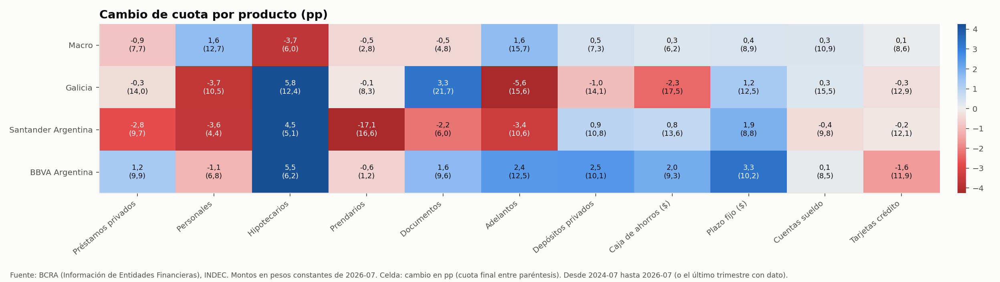
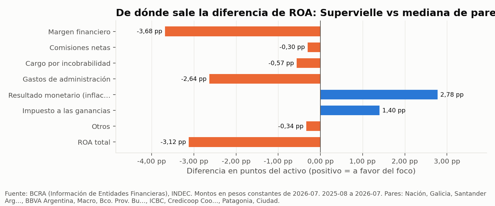
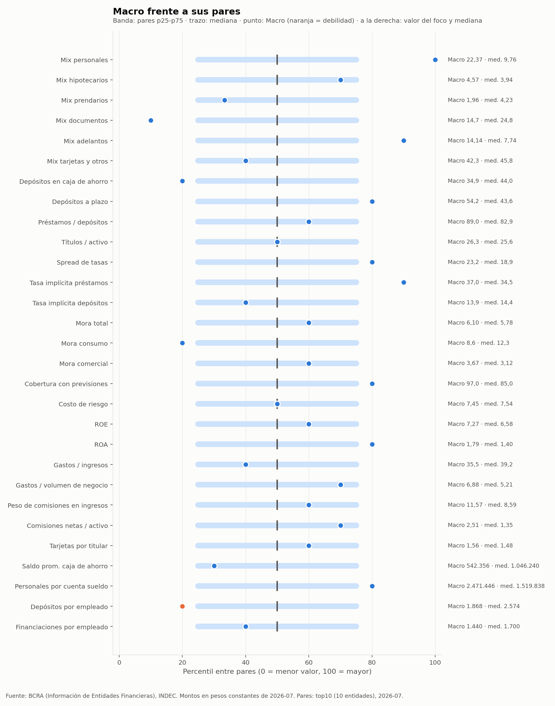
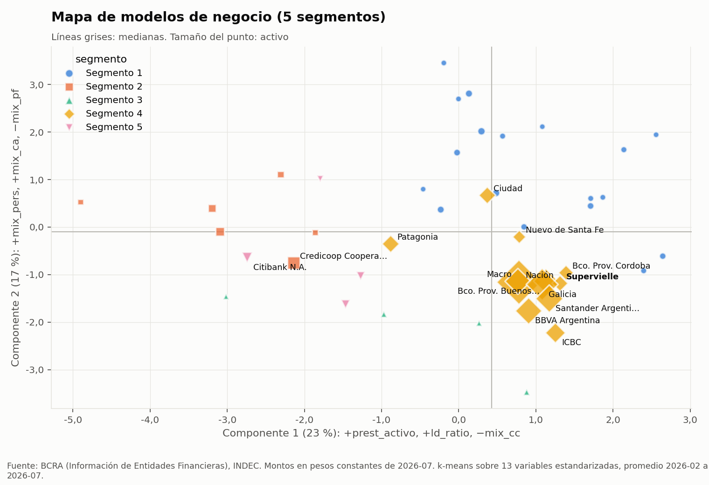

# Banking Metrics Analyst · Estratega Bancario (Argentina)

> *A Claude Skill that works like a senior banking strategist: it pulls official data on every Argentine bank, crosses it with the macro economy, runs the analyses a strategy team would run, has an independent reviewer check the work, and answers with sized business opportunities and charts. Spanish-language skill.*

Un **Skill de Claude** que trabaja como un analista de estrategia bancaria con 20 años de experiencia en el sistema financiero argentino.

Le hacés una pregunta de negocio en lenguaje natural, por ejemplo: *"¿en qué productos está perdiendo terreno el Banco Macro frente a Galicia, Santander y BBVA, y qué oportunidades tiene para 2027?"*. El skill:

1. **Baja los datos oficiales en vivo** de todos los bancos del BCRA, mes a mes desde 2014, a través de su capa de datos ([BCRA-Oracle](https://github.com/AGVD-CODE/BCRA-Oracle)), y las series macro del BCRA, el INDEC y datos.gob.ar.
2. **Corre los análisis** que haría un equipo de estrategia: cuotas de mercado, benchmarking contra pares, rentabilidad, correlaciones con la macro, segmentación por modelo de negocio, sensibilidad de la mora y detección de anomalías.
3. **Encuentra lo que no se ve a simple vista** y lo traduce en **oportunidades de negocio con tamaño en pesos**, priorizadas y con primer paso.
4. **Hace revisar el trabajo por un segundo analista independiente** (otro agente) antes de responder.
5. **Responde en el chat con gráficos.**

---

## ¿Para qué sirve?

Para quien necesita **decidir** con datos del sistema bancario argentino, no solo consultarlos:

| Quién | Para qué lo usa |
|---|---|
| **Estrategia y planeamiento de un banco** | Diagnóstico frente a la competencia, plan comercial anual, material para directorio |
| **Desarrollo de negocios y productos** | Dónde crecer, qué segmento atacar, cuánto vale cada oportunidad |
| **Riesgo de crédito** | Qué anticipa la mora, qué tan sensible es el banco al ciclo, efecto cosecha |
| **Consultores** | Propuestas con diagnóstico propio y oportunidades dimensionadas para un banco cliente |
| **Analistas e inversores** | Comparar bancos, entender modelos de negocio, detectar cambios de tendencia |

**La diferencia con preguntarle a un chat genérico:** los números salen de las fuentes oficiales en el momento de la consulta, no de memoria. Los montos se ajustan por inflación. Se controlan los errores de carga de las publicaciones y las fusiones. La fuerza estadística de cada hallazgo está calificada. Y un revisor independiente recalcula los números clave antes de que lleguen a vos.

---

## Ejemplos de consultas

**Competencia y cuota de mercado**
- *"¿En qué productos está perdiendo terreno el Banco Macro frente a Galicia, Santander y BBVA en los últimos dos años?"*
- *"¿Quién le está sacando cuota de préstamos personales a los bancos privados? ¿Crecen por mercado o por cuota?"*
- *"Armame un mapa de cuotas por producto de los 5 bancos más grandes desde 2024."*

**Benchmarking y rentabilidad**
- *"¿Dónde está Galicia frente a sus pares y cuánto vale cerrar cada brecha?"*
- *"¿Por qué Supervielle gana menos que sus competidores? ¿Es margen, riesgo, comisiones o costos?"*
- *"¿Qué banco es el más eficiente y qué lo explica?"*

**Mora, riesgo y ciclo**
- *"¿Qué variables de la macro anticipan la mora de consumo y con cuántos meses de rezago?"*
- *"¿Qué bancos son más sensibles a una caída del salario real?"*
- *"¿El crecimiento del crédito de 2024 es la mora de 2025-2026? ¿Qué bancos crecieron con más disciplina?"*

**Modelos de negocio**
- *"Segmentá a los bancos argentinos por modelo de negocio. ¿Cuál es el más rentable?"*
- *"¿Quiénes son los competidores reales del Banco Patagonia por modelo de negocio, no por tamaño?"*

**Oportunidades y plan comercial**
- *"Soy consultor y preparo una propuesta para Supervielle: ¿qué hay escondido en los datos que podrían aprovechar?"*
- *"¿Hay espacio para que un banco de mora baja gane cuota en personales mientras los demás frenan? ¿Cuánto vale?"*
- *"¿Qué banco tiene cuentas sueldo sin monetizar y cuánto crédito le falta por prestarle a esa base?"*

**Macro y contexto**
- *"¿Cómo afectó la desinflación de 2024 al margen financiero de los bancos?"*
- *"¿Qué cambió fuera de lo normal en el sistema en el último año?"*

Más ejemplos, con lo que hace el skill en cada caso, en [`docs/EJEMPLOS.md`](docs/EJEMPLOS.md).

---

## Qué vas a recibir

Una respuesta pensada para un comité de dirección:

1. **Titular:** el hallazgo principal y su tamaño.
2. **Lo que encontró:** 3 a 5 insights. Cada uno con el número, el porqué (mecanismo), qué tan robusta es la evidencia y qué haría un banco.
3. **Oportunidades priorizadas:** tamaño en stock **y** en resultado anual, escenarios (conservador, base y cota), dificultad, primer paso a 90 días y KPI de seguimiento.
4. **Gráficos:** 2 a 4, cada uno con una línea que dice qué mirar.
5. **Qué no sabemos:** límites de los datos y riesgos de la lectura.
6. **Fuentes y método:** períodos, base de pesos constantes y cuántas correcciones aplicó el revisor.

Ejemplos de gráficos que genera (datos oficiales a julio de 2026):

| Mapa de cuotas por producto (pro forma por fusiones) | De dónde sale la brecha de rentabilidad |
|---|---|
|  |  |

| Banco frente a sus pares (percentiles) | Mapa de modelos de negocio |
|---|---|
|  |  |

---

## Cómo funciona por dentro

```
Pregunta de negocio
   │
   ├─ 0. Encuadre: banco foco, pares, horizonte (sin frenar con preguntas)
   ├─ 1. Hipótesis de un estratega experimentado, antes de mirar datos
   ├─ 2. Datos oficiales en vivo: panel de bancos (lo arma bcra-oraculo, la capa de datos)
   │     + macro (BCRA, INDEC, datos.gob.ar)
   │     · pesos constantes · pro forma por fusiones (Macro + Itaú, Galicia + HSBC)
   ├─ 3. Control de calidad: errores de carga, saltos de cuota, fusiones, devaluación, blanqueo
   ├─ 4. Análisis: cuotas · brechas · rentabilidad · correlaciones · segmentación
   │     · sensibilidad macro · efecto cosecha · anomalías
   ├─ 5. Triangular: el hallazgo tiene que sobrevivir a otra ventana, otro método y otros pares
   ├─ 6. De hallazgo a negocio: dimensionar, priorizar, primer paso y KPI
   ├─ 7. Revisión independiente: otro agente recalcula los números clave y busca errores;
   │     si hubo críticos, segunda mirada corta solo sobre los cambios
   └─ 8. Respuesta en el chat con gráficos
```

### Análisis disponibles

| Análisis | Qué responde |
|---|---|
| `preparar` | Pasa todo a pesos constantes y calcula mix de cartera y fondeo, cuotas de mercado, crecimiento real, eficiencia, costo de riesgo, penetración (préstamos por cuenta sueldo, saldo por caja de ahorro) y mora sin dilución |
| `calidad` | Detecta errores de carga del BCRA (por ejemplo, Santander con 38,6 millones de tarjetas en junio de 2017, contra 5,8 millones el trimestre anterior), fusiones y saltos de cuota |
| `proforma` | Suma hacia atrás los bancos absorbidos, para que una fusión no parezca ganancia comercial |
| `cuotas` | Quién gana y quién pierde mercado; crecimiento por mercado o por cuota; concentración (HHI); mapa por producto |
| `brechas` | Percentil del banco entre sus pares y cuánto vale en pesos cerrar cada brecha (mix, penetración, *fair share*) |
| `rentabilidad` | Árbol del ROA: margen, comisiones, incobrabilidad, gastos, inflación e impuestos, contra pares y por segmento |
| `correlacion` | Qué variable macro anticipa a cuál métrica y con cuántos meses, con corrección estadística por autocorrelación y por comparaciones múltiples |
| `segmentar` | Modelos de negocio (k-means + Ward), su rentabilidad y los competidores reales de cada banco |
| `sensibilidad` | Cuánto le pega la macro a cada banco; efecto cosecha (el crédito de hoy como mora de mañana) |
| `anomalias` | Qué se movió fuera de lo normal, y si es sistémico o propio del banco |

### Cómo cuida el rigor

- **Nunca inventa datos:** todo número sale de un script corrido en la sesión, con período y fuente. Si un dato no se publica (por ejemplo, clientes por banco), lo dice y usa el proxy más cercano.
- **Conoce las trampas argentinas:**
  - inflación (pesos constantes y contabilidad por inflación desde 2020);
  - devaluaciones que inflan los saldos en dólares;
  - el alivio de mora de la pandemia (2020-2022);
  - fusiones;
  - cambios de régimen (cepo, LELIQ, LEFI, bandas cambiarias).
- **Califica la evidencia** como robusta, indicio o no concluyente, y nunca dice "causa" con evidencia de correlación.
- **Revisión independiente:** en las pruebas atrapó 2 errores críticos por análisis antes de llegar al usuario. Por ejemplo, una oportunidad valuada con tasas en pesos sobre saldos que en buena parte eran en dólares, o un cargo extraordinario contado dos veces.

---

## Alcance

**Incluye**
- **Argentina, entidades financieras supervisadas por el BCRA:** unos 60 bancos y, si se piden, las compañías financieras. Agregados del sistema, públicos, privados y 10 primeros privados.
- **Métricas por entidad** (mensuales desde 2014; algunas trimestrales):
  - balance, préstamos por línea y depósitos por tipo;
  - mora total, de consumo y comercial, y situación de deudores;
  - rentabilidad (ROE, ROA, margen, comisiones, gastos, resultado monetario);
  - tasas implícitas;
  - tarjetas, cuentas, cuentas sueldo, cuentas previsionales y empleados.
- **Macro mensual:** IPC general y núcleo, tipo de cambio, tasas (BADLAR, plazo fijo, personales), crédito y depósitos del sistema, EMAE, salarios, RIPTE, desocupación, PBI, reservas y expectativas de inflación (REM). También acepta cualquier otra serie de las APIs del BCRA y de datos.gob.ar.
- **Perspectiva:** la de un banco que busca crecer y ganar rentabilidad.

**No incluye**
- Datos de mercado en tiempo real (cotizaciones, acciones, bonos, dólar paralelo) ni noticias. Si hace falta contexto reciente, lo busca en la web y lo marca como tal.
- Datos por cliente, tasas por producto y banco, ni crédito por provincia y banco (el BCRA no los publica; el skill usa proxies y lo aclara).
- Billeteras y fintechs que no son entidades financieras (por ejemplo, Mercado Pago).
- Datos internos de un banco: trabaja con información pública.
- Pronósticos presentados como certezas.
- Otros países.

**Rezago:** el BCRA publica la información por entidad con unos 3 meses de rezago (4 en la trimestral). La respuesta siempre dice a qué mes corresponde.

---

## Requisitos y dependencias

| Requisito | Detalle |
|---|---|
| **Entorno de Claude con ejecución de código** | Recomendado: **Claude Code**, donde el revisor independiente corre como un agente separado. En **claude.ai**, con la herramienta de análisis activa, el skill hace la revisión él mismo con la misma lista de control |
| **Python 3.8+** | `pandas`, `numpy`, `scipy`, `scikit-learn`, `statsmodels`, `matplotlib` (ver [`requirements.txt`](skill/estratega-bancario/scripts/requirements.txt)) |
| **pdftotext** (poppler) | Para la historia mensual desde los PDF del BCRA. Sin él, el skill funciona con los últimos 5 períodos de la API y lo avisa |
| **Acceso de red** | `www.bcra.gob.ar`, `api.bcra.gob.ar`, `apis.datos.gob.ar`, `www.indec.gob.ar` |
| **Skill bcra-oraculo 2.1 o posterior** (misma versión mayor, 2.x) | Es la capa de datos: arma el panel de bancos desde el BCRA. Se instala aparte, desde [BCRA-Oracle](https://github.com/AGVD-CODE/BCRA-Oracle/releases). El estratega lo busca solo y controla su versión; si falta o no es compatible, lo dice y explica qué instalar |
| **Skill riesgo-bancario 1.0 o posterior** (opcional) | Es la capa de riesgo: salud tipo CAMELS, prueba de estrés y alertas de maquillaje de cartera. El estratega la usa para filtrar el riesgo de cada oportunidad y en el resumen del mes. Se instala aparte, desde [Banking-Risk-Analyst](https://github.com/AGVD-CODE/Banking-Risk-Analyst/releases), y necesita bcra-oraculo 2.2. Si falta, el estratega sigue y lo aclara |
| **Skill revisor-independiente 1.0 o posterior** (misma versión mayor, 1.x) | Es la capa de control: revisa cada análisis antes de que llegue a vos. Se instala aparte, desde [Independent-Reviewer](https://github.com/AGVD-CODE/Independent-Reviewer/releases). Si falta, el estratega hace una revisión reducida y te avisa qué instalar |

**Tiempo y costo:** un análisis completo, con datos, varios análisis, revisión y gráficos, lleva unos **30 a 45 minutos** y del orden de **300 a 400 mil tokens**. Es un trabajo de analista, no una consulta rápida. Para un dato suelto ("¿cuántas tarjetas tiene Galicia?") conviene el skill complementario [BCRA-Oracle](https://github.com/AGVD-CODE/BCRA-Oracle), que responde en segundos.

---

## Instalación

Se instalan **tres skills**: el estratega, su capa de datos (bcra-oraculo) y su revisor (revisor-independiente). Conviene sumar un cuarto, **riesgo-bancario**, para el filtro de riesgo.

**En claude.ai**
1. Descargá [`estratega-bancario.skill`](estratega-bancario.skill), `bcra-oraculo.skill` de la [última release de BCRA-Oracle](https://github.com/AGVD-CODE/BCRA-Oracle/releases/latest) y `revisor-independiente.skill` de la [última release de Independent-Reviewer](https://github.com/AGVD-CODE/Independent-Reviewer/releases/latest). Opcional: `riesgo-bancario.skill` de la [última release de Banking-Risk-Analyst](https://github.com/AGVD-CODE/Banking-Risk-Analyst/releases/latest).
2. Andá a Configuración → Skills (según la versión, Capacidades → Skills) y subí los archivos.
3. Activá la herramienta de análisis (ejecución de código) y habilitá el acceso de red a los dominios de la tabla de requisitos.

**En Claude Code**
```bash
git clone https://github.com/AGVD-CODE/Banking-Metrics-Analyst.git
git clone https://github.com/AGVD-CODE/BCRA-Oracle.git
git clone https://github.com/AGVD-CODE/Independent-Reviewer.git
git clone https://github.com/AGVD-CODE/Banking-Risk-Analyst.git
mkdir -p ~/.claude/skills
cp -R Banking-Metrics-Analyst/skill/estratega-bancario BCRA-Oracle/skill/bcra-oraculo Independent-Reviewer/skill/revisor-independiente Banking-Risk-Analyst/skill/riesgo-bancario ~/.claude/skills/
pip install -r ~/.claude/skills/estratega-bancario/scripts/requirements.txt
```

**Para actualizar** cualquiera de los tres, reemplazá su carpeta (o volvé a subir su `.skill`). Cada uno se mejora por su cuenta: mientras bcra-oraculo o el revisor no cambien de versión mayor, el estratega usa la versión nueva sin tocarlo.

Instalá también pdftotext, con el comando de tu sistema:
```bash
brew install poppler
```
```bash
sudo apt-get install -y poppler-utils
```

Después, en cualquier conversación, hacé tu pregunta de negocio sobre bancos argentinos: el skill se activa solo.

---

## Consejos para sacarle provecho

- **Nombrá el banco foco y, si querés, los pares:** "Macro contra Galicia, Santander y BBVA". Si no, compara contra los 10 más grandes o contra los de su mismo modelo de negocio.
- **Decí para qué es:** "para el directorio", "para una propuesta de consultoría", "para el plan 2027". El encuadre cambia el foco.
- **Pedí el horizonte:** "en los últimos dos años", "desde 2016". Para relaciones con la macro conviene historia larga.
- **Repreguntá:** "¿cuánto vale eso en resultado?", "¿y si lo medimos sin la fusión?", "mostrame la evolución mensual".

---

## Cómo se probó

Se probó con tres preguntas reales:
- el diagnóstico de Macro frente a los grandes privados;
- qué anticipa la mora de consumo;
- la segmentación del sistema con una propuesta para Supervielle.

Cada pregunta se respondió con el skill y sin el skill, y un corrector independiente calificó las respuestas con 10 a 12 criterios verificables. Algunos ejemplos de criterios: consistencia de los números, oportunidades con resultado anual, mediana contra promedio ponderado.

| Versión | Criterios cumplidos |
|---|---|
| Skill actual (con revisor) | **33 de 33** |
| Versión anterior del skill (sin revisor) | 31 de 33 |
| Sin skill | 29 de 33 |

En las tres preguntas, el corrector eligió la respuesta del skill actual como la más sólida. Los casos de prueba están en [`skill/estratega-bancario/evals/`](skill/estratega-bancario/evals/) y el detalle, en [`docs/PRUEBAS.md`](docs/PRUEBAS.md).

---

## Estructura del repositorio

```
Banking-Metrics-Analyst/
├── README.md
├── LICENSE
├── CHANGELOG.md
├── estratega-bancario.skill        → skill empaquetado, listo para instalar
├── skill/estratega-bancario/
│   ├── SKILL.md                    → instrucciones del analista (criterio, flujo, reglas de rigor, formato)
│   ├── references/
│   │   ├── metodologia.md          → cómo leer cada análisis y checklist de robustez
│   │   ├── contexto_argentino.md   → regímenes 2014-2026, inflación, fusiones, estructura del sistema
│   │   ├── oportunidades.md        → playbook de hipótesis, dimensionamiento y priorización
│   │   ├── revision_bancaria.md    → lista de control bancaria que se le pasa al revisor
│   │   ├── fuentes_macro.md        → catálogo de series macro y trampas de cada fuente
│   │   └── contrato.md             → qué necesita, qué entrega y cómo se versiona
│   ├── scripts/
│   │   ├── panel.py                → panel de bancos: ubica bcra-oraculo, controla su versión y le pide el panel
│   │   ├── revisor.py              → ubica revisor-independiente y controla su versión
│   │   ├── filtro_riesgo.py        → usa riesgo-bancario (opcional) para el filtro de riesgo
│   │   ├── macro_ar.py             → series macro mensuales
│   │   ├── analizar.py             → los análisis (incluido el resumen del mes, novedades)
│   │   ├── graficos.py             → estilo y gráficos
│   │   ├── _comun.py               → versión del skill y búsqueda de bcra-oraculo y del revisor
│   │   └── requirements.txt
│   └── evals/                      → casos de prueba (formato `claude plugin eval`)
└── docs/
    ├── EJEMPLOS.md
    ├── PRUEBAS.md
    └── img/
```

---

## Limitaciones

- **Depende de fuentes oficiales que cambian sin aviso.** Si el BCRA o el INDEC cambian un formato, una descarga puede fallar. El skill lo informa y no responde de memoria. `references/fuentes_macro.md` (macro) y `references/fuentes.md` de bcra-oraculo (entidades) explican cómo adaptarlo.
- **Son datos públicos y agregados por entidad.** Sirven para estrategia y benchmarking, no para decisiones de crédito individuales.
- **Las oportunidades son órdenes de magnitud con supuestos explícitos**, no metas. Hay que validarlas con la rentabilidad interna por producto de cada banco.
- **Las correlaciones con la macro dependen del régimen.** Con pocos ciclos completos, el skill las informa como rangos y califica su fuerza.

---

## Arquitectura en capas

Este skill es una pieza de una biblioteca de skills especializados que se encadenan. Cada uno se mejora por su cuenta y le pasa su resultado al siguiente:

```
bcra-oraculo 2.x ──► estratega-bancario 1.x ──► revisor-independiente 1.x
 capa de datos   │    capa de análisis           capa de control: revisa antes de entregar
                 │          │
                 │          ▼ (opcional)
                 └──► riesgo-bancario 1.x
                      capa de riesgo: salud, estrés y alertas de cartera
```

Futuras capas posibles: rentabilidad por producto, presentación para el directorio.

El revisor es general: el estratega le pasa su lista de control bancaria, y cualquier otro skill que produzca análisis con números puede usarlo con su propia lista.

**Cómo se mantienen independientes:** cada skill publica un **contrato** (qué recibe, qué entrega y en qué formato) con número de versión.
- Las mejoras que no rompen el contrato suben la versión menor y llegan solas a los skills que dependen de él.
- Un cambio de contrato sube la versión mayor. El skill que depende lo detecta y avisa, en lugar de fallar en silencio.

Contratos: el de este skill en [`references/contrato.md`](skill/estratega-bancario/references/contrato.md), el de bcra-oraculo en su [`references/contrato.md`](https://github.com/AGVD-CODE/BCRA-Oracle/blob/main/skill/bcra-oraculo/references/contrato.md) y el del revisor en su [`references/contrato.md`](https://github.com/AGVD-CODE/Independent-Reviewer/blob/main/skill/revisor-independiente/references/contrato.md).

---

## Fuentes oficiales

- BCRA, Información de Entidades Financieras: https://www.bcra.gob.ar/total-del-sistema-financiero/
- BCRA, API de Estadísticas: https://api.bcra.gob.ar/estadisticas/v4.0/monetarias
- INDEC, Índice de Precios al Consumidor: https://www.indec.gob.ar/indec/web/Nivel4-Tema-3-5-31
- Ministerio de Economía, Series de Tiempo (datos.gob.ar): https://datos.gob.ar/series (documentación de la API: https://datosgobar.github.io/series-tiempo-ar-api/)

## Proyectos relacionados

- [BCRA-Oracle](https://github.com/AGVD-CODE/BCRA-Oracle) (`bcra-oraculo`): la capa de datos. Responde en segundos datos puntuales del sistema financiero argentino (BCRA e INDEC) y le arma a este skill los paneles de bancos.

## Licencia

MIT. Ver [LICENSE](LICENSE). Libre para usar, modificar y redistribuir, manteniendo el aviso de copyright.

## Autor

Alejandro Vaamonde

---

*Este proyecto no está afiliado ni respaldado por el BCRA, el INDEC, el Ministerio de Economía ni Anthropic. Usa datos públicos de fuentes oficiales. Los ejemplos que mencionan bancos son ilustrativos y no constituyen recomendación de inversión.*
