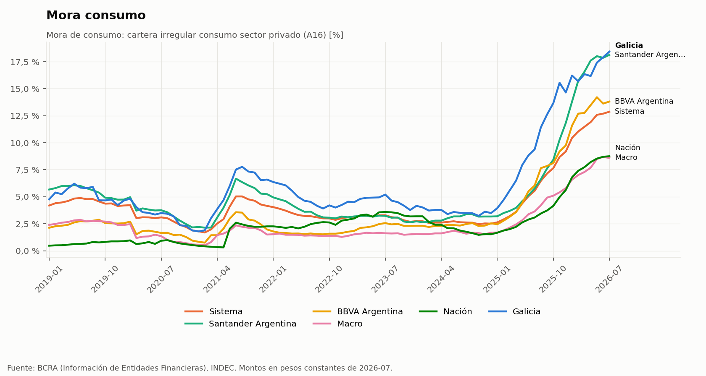

# Ejemplos de consultas

Catálogo de preguntas de negocio que el skill sabe trabajar, organizadas por tema. Para cada grupo se indica qué análisis corre y qué tipo de hallazgo suele aparecer. Todas se responden con datos oficiales bajados en el momento de la consulta.

> **Consejo:** cuanto más concreta la pregunta (banco foco, pares, período, para qué es), más afilada la respuesta. El skill asume lo razonable cuando falta algo y lo dice.

---

## 1. Competencia y cuota de mercado

- ¿En qué productos está perdiendo terreno el Banco Macro frente a Galicia, Santander y BBVA en los últimos dos años?
- ¿Quién le está sacando cuota de préstamos personales a los bancos privados desde 2024?
- El Galicia creció mucho: ¿creció por el mercado o porque le ganó clientes a otros?
- Armame un mapa de cuotas por producto (personales, hipotecarios, prendarios, documentos, adelantos, depósitos, cuentas sueldo, tarjetas) para los 5 bancos más grandes.
- ¿Qué productos se están concentrando en pocos bancos y cuáles siguen fragmentados?

**Qué corre:** `cuotas` (un producto en detalle, o un mapa de varios), con descomposición del crecimiento en efecto mercado × efecto cuota, concentración (HHI) y momentum reciente. Antes, `calidad` y `proforma`, para que fusiones como Macro con Itaú o Galicia con HSBC no aparezcan como ganancia comercial.

**Hallazgo típico:** "Macro pierde cuota en préstamos a empresas e hipotecarios, pero gana en personales; la pérdida total equivale a $X billones de stock".

---

## 2. Benchmarking y brechas contra pares

- ¿Dónde está Galicia frente a los 10 bancos más grandes, en qué es fuerte y en qué es débil?
- Comparame a Supervielle con sus competidores reales por modelo de negocio, no por tamaño.
- ¿Cuánto vale para BBVA llevar su mix de cartera al de sus pares?
- ¿Qué banco tiene cuentas sueldo o jubilados sin monetizar en préstamos?

**Qué corre:** `brechas` (percentil entre pares en unas 30 métricas, con el tamaño en pesos de cerrar cada brecha: mix, penetración y *fair share*) y `segmentar` (para elegir los pares por modelo de negocio).

---

## 3. Rentabilidad

- ¿Por qué Supervielle gana menos que sus pares? ¿Es margen, riesgo, comisiones o costos?
- ¿Cuánto resultado por año pierde un banco por tener gastos por encima de la mediana?
- ¿Qué modelo de negocio es el más rentable, mirando el banco típico y el negocio en conjunto?
- ¿Cómo afectó la desinflación al margen financiero y al resultado monetario de los bancos?

**Qué corre:** `rentabilidad` (árbol del ROA de los últimos 12 meses: margen financiero, comisiones, incobrabilidad, gastos, resultado monetario e impuesto). Compara contra la mediana de los pares y, con `--segmentos`, por modelo de negocio, con ROE ponderado y mediano.

**Hallazgo típico:** "La brecha no está en el margen: neto del resultado monetario es igual al de sus pares. Está en los gastos, que suman 2,6 puntos del activo, unos $225 mil millones por año".

---

## 4. Mora, riesgo y ciclo

- ¿Qué variables de la macro anticipan la mora de consumo y con cuántos meses de rezago?
- ¿Qué bancos son más sensibles a una caída del salario real? ¿Cuáles son defensivos?
- ¿El boom de crédito de 2024 explica la mora de 2025-2026? ¿Qué bancos crecieron con más disciplina?
- ¿Estamos cerca del pico de mora? ¿Qué dice la situación 2?
- ¿La mora baja de un banco es real o está diluida porque creció rápido?

**Qué corre:**
- `correlacion` temporal: con rezagos, sobre variaciones, con n efectivo, corrección por comparaciones múltiples y control por inflación.
- `sensibilidad`: por banco y en panel, incluido el efecto cosecha con `--x-propias`.
- Mora sin dilución.
- Exclusión del alivio de la pandemia (2020-2022).

**Hallazgo típico:** "El crecimiento real del crédito anticipa la mora de consumo en unos 10 a 12 meses. Por cada 10 puntos de crecimiento, la mora sube entre 0,3 y 0,5 puntos. Galicia y Provincia son los más sensibles; Macro y Nación, los más defensivos".

---

## 5. Modelos de negocio

- Segmentá a los bancos argentinos por modelo de negocio. ¿Cuál es el más rentable?
- ¿Qué bancos están cambiando de modelo?
- ¿Qué tienen en común los bancos con ROE alto y mora baja?

**Qué corre:** `segmentar` (k-means y Ward sobre estructura de cartera y fondeo, con la calidad de los segmentos informada), `rentabilidad --segmentos` y `correlacion --modo transversal`.

---

## 6. Oportunidades y plan comercial

- Soy consultor y preparo una propuesta para Supervielle: ¿qué hay escondido en los datos que podrían aprovechar?
- ¿Hay espacio para que un banco de mora baja gane cuota en personales mientras los demás frenan? ¿Cuánto vale?
- Necesito tres oportunidades para el plan 2027 de Banco Patagonia, con tamaño y primer paso.
- ¿Qué productos tienen viento a favor (por ejemplo, hipotecarios UVA) y quién está mejor posicionado?

**Qué corre:** todo lo anterior, según el caso, y el playbook de `references/oportunidades.md`. Cada oportunidad sale con tamaño en stock y en resultado anual, escenarios (25 %, 50 % y 100 % de la brecha), dificultad, primer paso a 90 días y KPI.

---

## 7. Señales y anomalías

- ¿Qué cambió fuera de lo normal en el sistema en el último año?
- ¿Algún banco se está despegando de sus pares en mora o en crecimiento?
- ¿Hay errores o saltos raros en los datos del BCRA de este banco?

**Qué corre:** `anomalias` (z robusto contra su historia y contra sus pares, para separar lo sistémico de lo propio) y `calidad`.

---

## Repreguntas útiles

- "¿Cuánto vale eso en resultado anual?"
- "¿Y si lo medimos sin la fusión?" o "¿y desde 2016?"
- "Mostrame la evolución mensual de la cuota."
- "¿Qué tan robusta es esa relación? ¿Se mantiene en otra ventana?"
- "Armalo como resumen para el directorio."

## Qué no responde

- Cotizaciones, acciones, bonos o dólar paralelo, ni noticias como fuente principal.
- Datos por cliente, tasas por producto y banco, o crédito por provincia y banco (el BCRA no los publica).
- Billeteras que no son entidades financieras.
- Otros países.
